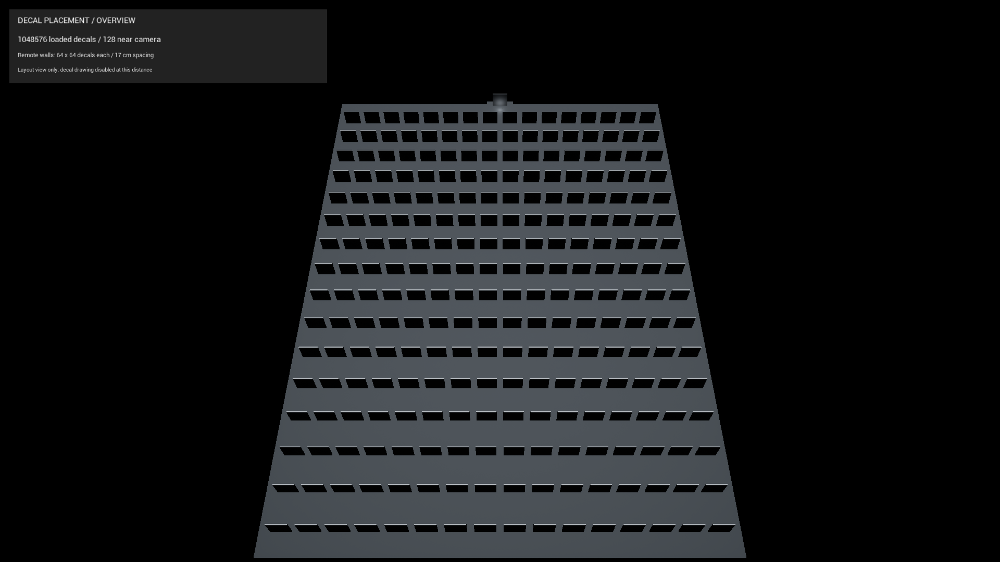
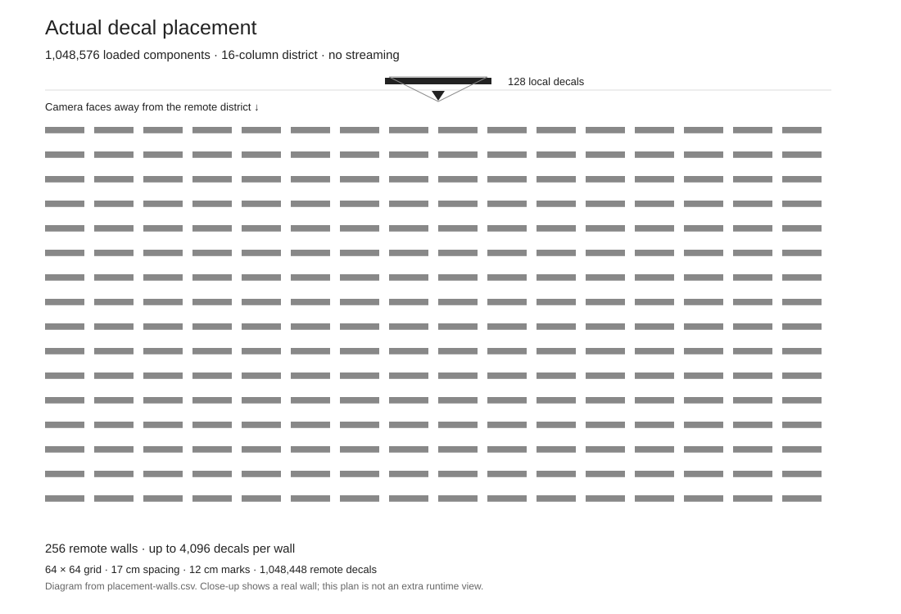
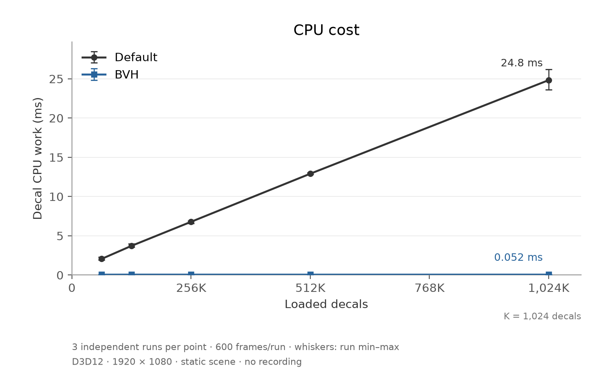
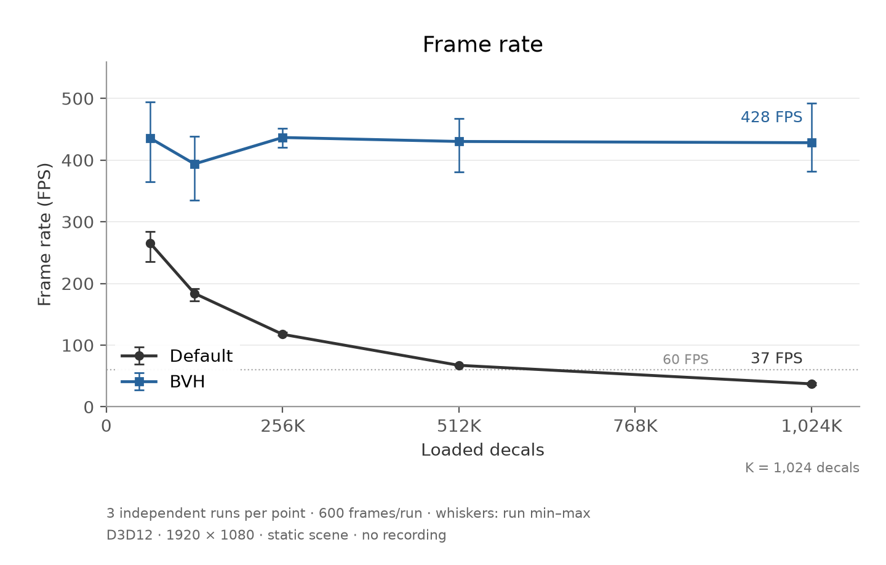

# Decal BVH — one-minute demonstration

[Live demo](https://d1tan.github.io/decal-bvh/) · [Measured data](assets/scalability-results.json)

## Core implementation

[Actual C++ excerpts](code/core-excerpts.cpp) · [Integration notes](code/README.md)

- **Cache geometry:** reuse an immutable render-thread snapshot until invalidated.
- **Prune groups:** median-split BVH rejects off-screen nodes instead of scanning every decal.
- **Preserve results:** restore scene order, then keep UE's original filters and stage sorting.
- **Handle difficult cases:** retain conservative candidates and fall back when indexing is unsuitable.

## Camera and scene

<a href="assets/placement-overview.png"></a> <a href="assets/placement.svg"></a>

128 local decals near the camera; 1,048,448 on remote walls behind it. Overview is layout-only, with decal drawing disabled. Click either image to inspect.

<!-- BEGIN SCALABILITY -->
## Scalability

Same camera route and 128 local decals; increase the loaded off-screen population. Five sizes, three independent runs per size/mode, 600 sampled frames/run after 1,000 + 300 warmup frames. Headline and charts use this matrix.

| Decals | Default CPU / ms | BVH CPU / ms | Default FPS | BVH FPS |
|---:|---:|---:|---:|---:|
| 65,536 | 2.059 | 0.048 | 265.0 | 435.3 |
| 131,072 | 3.717 | 0.053 | 183.9 | 393.7 |
| 262,144 | 6.781 | 0.051 | 117.5 | 436.6 |
| 524,288 | 12.905 | 0.049 | 67.3 | 430.1 |
| 1,048,576 | 24.821 | 0.052 | 37.2 | 428.1 |





CPU = invalidation + Prepare + visibility + stage work. FPS = 1,000 / mean wall-clock tick interval. Whiskers are run min/max, not confidence intervals. All 30 runs share settings, binaries and visible-count trajectories; placement matches within each size. No sampled rebuilds or discarded frames.

[Settings and checks](assets/scalability-results.json) · [Summary CSV](assets/scalability-summary.csv) · [Run CSV](assets/scalability-runs.csv) · [CPU SVG](assets/scalability-cpu.svg) · [FPS SVG](assets/scalability-fps.svg)
<!-- END SCALABILITY -->

## Scope and media

Win64 Development Editor, D3D12/1080p, i9-13980HX / RTX 4080 Laptop; quality 3, Lumen/VSM off, no VSync/frame cap/dynamic resolution. This is a static low-visibility stress test. Frequent updates can force expensive rebuilds; production-content performance is untested.

The million-decal scene has 128 local decals and 1,048,448 on 256 remote walls. Each full wall contains 4,096 components in a 64 × 64 grid, with 17 cm spacing and 12 cm marks. All remain loaded. Placement uses saved coordinates and native UE screenshots; the close-up has an inspection fill light.

Video uses own-window capture at a requested 60 FPS ceiling with preserved timestamps and no speed changes. Its HUD is live; headline/charts come from separate unrecorded runs. Recording adds overhead. Inspection views are excluded from timing.

## Run locally

`index.html` is the webpage entry point. `app.js` fills the statistics and switches views; the UE footage is recorded video.

Clone this repository and open `index.html`, or serve the folder:

```sh
python -m http.server 8000
```

Open [localhost:8000](http://localhost:8000). The static showcase has no build step or external dependencies; charts open at full size when clicked.

This repository hosts presentation assets and benchmark summaries. Measurements were captured in a local Unreal Engine Development Editor.
